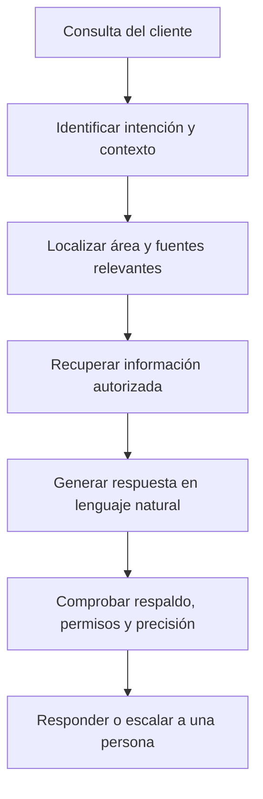
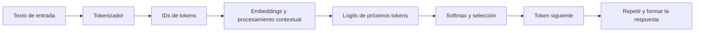

# Módulo 2 — Fundamentos de la inteligencia artificial generativa

**Curso:** Alfabetización en Inteligencia Artificial: Competencias Esenciales y Pensamiento Crítico (Alura Latam)  
**Aula:** 2  
**Idioma:** Español  
**Tipo de material:** Apuntes de estudio y desarrollo de actividad práctica

> **Objetivo:** Comprender cómo los sistemas de IA generativa procesan solicitudes, el papel de los LLM, los tokens y los parámetros de generación, y aplicar criterios de verificación para evitar conclusiones no fundamentadas.

## Índice

1. [Qué es la IA generativa y cómo responde](#1-qué-es-la-ia-generativa-y-cómo-responde)
2. [Mapa de áreas y fuentes de conocimiento](#2-mapa-de-áreas-y-fuentes-de-conocimiento)
3. [LLM, tokens, embeddings y predicción](#3-llm-tokens-embeddings-y-predicción)
4. [Parámetros de creatividad](#4-parámetros-de-creatividad)
5. [Alucinaciones, fuentes y validación](#5-alucinaciones-fuentes-y-validación)
6. [Herramientas y aplicaciones](#6-herramientas-y-aplicaciones)
7. [Infraestructura e impacto ambiental](#7-infraestructura-e-impacto-ambiental)
8. [Actividad práctica resuelta](#8-actividad-práctica-resuelta)
9. [Caso adicional: Fokus](#9-caso-adicional-fokus)
10. [Plantilla de prompt $P](#10-plantilla-de-prompt-p)
11. [Conclusiones y referencias](#11-conclusiones-y-referencias)

---

## 1. Qué es la IA generativa y cómo responde

La **IA generativa** crea texto, imágenes, audio, código u otros contenidos a partir de instrucciones y contexto. Los modelos de lenguaje extensos (**LLM**, *Large Language Models*) son una de sus principales tecnologías.

En un asistente empresarial conectado a fuentes internas, una consulta puede seguir este proceso:



**Ejemplo: estado de un reembolso.** El usuario pregunta: «¿Cuál es el estado de mi reembolso?». El sistema identifica el tema *reembolso*, busca en **Pagos y facturación**, consulta el estado real de la solicitud mediante un sistema autorizado y responde. **Un LLM sin acceso al expediente no puede saber el estado real**: no debe inventar un ID, fecha ni resultado.

Esta búsqueda en sistemas o documentos **no ocurre automáticamente en todos los LLM**: necesita una integración, herramienta o mecanismo de recuperación (por ejemplo, RAG, *retrieval-augmented generation*).

## 2. Mapa de áreas y fuentes de conocimiento

**Organización ficticia:** SwiftBank, una aplicación de servicios financieros digitales.

| Área | Fuentes ideales | Consultas típicas | Condiciones de seguridad |
|---|---|---|---|
| Pagos y facturación | Base transaccional; sistema de reembolsos; políticas vigentes | Estado de reembolso; comisiones; pagos duplicados | Autenticación, acceso autorizado, datos actualizados |
| Cuentas y acceso | Centro de ayuda; registros de seguridad; gestión de identidad | Recuperación de acceso; bloqueo de cuenta | Verificación de identidad y canales seguros |
| Entrega y logística | Seguimiento de tarjetas; operador logístico | ¿Dónde está mi tarjeta física? | Confirmar número de seguimiento y destinatario |
| Atención al cliente | Base de conocimiento aprobada; registro de casos | Preguntas frecuentes; seguimiento del ticket | Historial correcto y política de escalamiento |
| Riesgos y fraude | Sistema antifraude; procedimientos de disputas | Cargo no reconocido; sospecha de fraude | Escalamiento a equipo especializado |
| Legal y cumplimiento | Normativa aplicable; políticas oficiales | Privacidad; condiciones contractuales | Revisión por personal autorizado |

**Regla práctica:** para una pregunta factual, priorizar una fuente primaria, vigente y autorizada. No utilizar una respuesta probable en lugar de un dato comprobado.

## 3. LLM, tokens, embeddings y predicción

### Conceptos principales

| Término | Explicación |
|---|---|
| **Token** | Unidad en que el *tokenizador* divide el texto: puede ser una palabra, parte de ella, signo o espacio según el sistema. |
| **Tokenización** | Separación del texto en tokens mediante reglas y un vocabulario específico. |
| **ID de token** | Identificador numérico asignado a cada token. |
| **Embedding** | Vector numérico aprendido que representa un token u otra unidad de información. |
| **Logit** | Puntuación no normalizada que el modelo asigna a posibles tokens siguientes. |
| **Softmax** | Transformación de logits a una distribución de probabilidades. |
| **Temperatura** | Parámetro que modifica la distribución de elección durante el muestreo. |
| **Top-k** | Restringe la elección a los *k* candidatos con mayor puntuación/probabilidad. |
| **Top-p** | Restringe la elección al conjunto mínimo cuya probabilidad acumulada alcanza el umbral *p*. |

### Flujo conceptual simplificado



La tokenización **no es lo mismo** que crear embeddings. Tampoco hay un número universal de tokens para una palabra: «negocios» puede dividirse de distintas formas dependiendo del tokenizador. La similitud semántica se suele calcular entre **vectores contextualizados o embeddings de textos**, no simplemente contando caracteres o tokens.

### Fórmula simplificada

Para un candidato *i* y temperatura `T > 0`:

\[
P(i)=\frac{e^{z_i/T}}{\sum_j e^{z_j/T}}
\]

Donde `z_i` es su logit. Con una temperatura menor, la distribución suele concentrarse más en opciones probables; con una mayor, aumenta la diversidad de elecciones. **No garantiza creatividad de calidad ni veracidad.** Las interfaces comerciales pueden no exponer estos parámetros.

## 4. Parámetros de creatividad

| Configuración | Tendencia típica | Riesgo o límite |
|---|---|---|
| Temperatura baja | Respuestas más estables y conservadoras | Menos variedad; aún puede haber errores |
| Temperatura media | Equilibrio entre variedad y estabilidad | No asegura relevancia práctica |
| Temperatura alta | Más diversidad y variación | Puede aumentar incoherencias o afirmaciones poco sustentadas |
| Top-k menor | Menos candidatos posibles | Puede descartar opciones útiles |
| Top-p menor | Conjunto de candidatos más concentrado | Puede volver repetitiva la salida |

**Buenas prácticas:** conservar constante el mismo modelo, la instrucción y el contexto cuando se experimenta con temperatura; ejecutar varias repeticiones y evaluar la calidad usando una rúbrica. No todas las aplicaciones permiten configurar temperatura, top-k o top-p.

## 5. Alucinaciones, fuentes y validación

Una **alucinación** es una salida que presenta información falsa o no respaldada como si fuera cierta. Una respuesta fluida o convincente **no equivale** a una respuesta verificada.

### ChatGPT y NotebookLM en la clase

| Caso | Enfoque útil | Precaución |
|---|---|---|
| Análisis abierto de bancos y billeteras digitales de Perú | Investigación con ChatGPT y fuentes verificables | Revisar fechas, citas, cifras y cobertura de competidores |
| Análisis de un reporte concreto de 34 competidores | NotebookLM con documento(s) cargado(s) | Verificar las citas y las páginas; pueden existir errores de interpretación |
| Preparación para examen o presentación | NotebookLM para notas, guías, tarjetas, preguntas y resúmenes en audio | Contrastar con la fuente original antes de usar resultados |

**Importante:** acotar las fuentes puede reducir respuestas no sustentadas, pero **no elimina** las alucinaciones. Los documentos internos deben tratarse conforme a las políticas de privacidad y autorización de la organización.

### Lista de verificación

- [ ] ¿La respuesta usa datos existentes y accesibles, o inventa detalles?
- [ ] ¿Las fuentes son primarias, oficiales o suficientemente confiables?
- [ ] ¿Los enlaces y las páginas citadas respaldan exactamente cada afirmación?
- [ ] ¿La información corresponde a la fecha y jurisdicción correctas?
- [ ] ¿Distingue hechos, estimaciones, supuestos y opiniones?
- [ ] ¿Protege datos privados y escala las consultas sensibles?
- [ ] ¿Se revisó el resultado por una persona competente cuando el riesgo lo exige?

## 6. Herramientas y aplicaciones

| Herramienta / familia | Uso principal en el curso |
|---|---|
| ChatGPT (OpenAI) | Generación de texto, investigación asistida, análisis y aprendizaje |
| Claude (Anthropic) | Asistencia conversacional, análisis y redacción |
| Gemini (Google) | Asistencia multimodal y trabajo con información |
| Llama (Meta) | Familia de modelos de lenguaje |
| DeepSeek | Familia de modelos y asistentes de IA |
| NotebookLM (Google) | Consulta y síntesis fundamentada en fuentes incorporadas al cuaderno |

**Nota:** ChatGPT, Claude y Gemini son productos/asistentes; Llama y otras denominaciones también pueden referirse a familias de modelos. No deben tratarse todas como categorías técnicamente idénticas.

## 7. Infraestructura e impacto ambiental

El uso y entrenamiento de sistemas de IA requieren infraestructura física: chips, servidores, almacenamiento, redes y centros de datos. Los principales impactos incluyen:

- **Cómputo:** capacidad de entrenamiento e inferencia.
- **Electricidad:** abastecimiento continuo y eficiencia energética.
- **Refrigeración:** enfriamiento por aire o líquidos, con posibles impactos en consumo de agua.
- **Redes y almacenamiento:** movimiento y conservación de grandes volúmenes de datos.
- **Sostenibilidad:** medición de emisiones, uso de fuentes energéticas y mejora de eficiencia.

Las afirmaciones sobre «el mayor centro de datos» o fechas específicas deben verificarse antes de publicarse como hechos actuales; aquí se presentan los conceptos generales vistos en clase.

---

## 8. Actividad práctica resuelta

**Importante sobre el alcance:** las tablas de consultas, resultados y errores que siguen son **ejemplos simulados**, no registros de pruebas reales contra un banco, un modelo concreto o su API. Se agrega un protocolo reproducible para obtener resultados propios.

### Ejercicio 1 — Mapear áreas y documentos

Ver el [mapa de áreas y fuentes](#2-mapa-de-áreas-y-fuentes-de-conocimiento). Para implementarlo en una organización real se requiere: inventario de fuentes, responsables, permisos de lectura, frecuencia de actualización, y reglas de privacidad/escalamiento.

### Ejercicio 2 — Simular consultas y seleccionar la fuente ideal

| Consulta simulada | Intención | Fuente/área correcta | Respuesta segura esperada |
|---|---|---|---|
| «¿Dónde está mi tarjeta?» | Seguimiento de entrega | Logística y operador de envíos | Solicitar autenticación y consultar seguimiento; no inventar fechas |
| «¿Cuál es el estado de mi reembolso?» | Reembolso | Pagos y facturación; sistema de casos | Consultar ID de caso y estado real tras verificar identidad |
| «Olvidé mi contraseña» | Recuperación de cuenta | Cuentas y acceso | Remitir al flujo seguro de recuperación, sin pedir contraseña |
| «No reconozco un cargo» | Posible fraude | Riesgos, fraude y disputas | Priorizar seguridad, proceso oficial y escalamiento humano |
| «¿Cuál es la comisión de transferencia?» | Tarifa | Tarifario vigente de pagos | Citar tarifa publicada, fecha y condiciones |

**Hallazgo:** clasificar el área correcta es solo el primer paso; una respuesta sobre datos personales requiere acceso autorizado al registro pertinente.

### Ejercicio 3 — Dividir frases en tokens y evaluar similitud semántica

**Frases de prueba:**

- A: «Necesito conocer el estado de mi reembolso».
- B: «Quiero consultar el seguimiento de mi devolución».
- C: «¿Cuándo llega mi tarjeta física?».

**Segmentación didáctica por palabras** (no equivale a tokens reales de un LLM):

| Frase | Segmentación ilustrativa |
|---|---|
| A | Necesito / conocer / el / estado / de / mi / reembolso |
| B | Quiero / consultar / el / seguimiento / de / mi / devolución |
| C | Cuándo / llega / mi / tarjeta / física |

**Juicio semántico cualitativo esperado:** A y B tienen similitud **alta** porque preguntan por el estado de una devolución; A y C, y B y C tienen similitud **menor** porque C trata sobre una entrega. Este juicio es humano e ilustrativo: **no es un puntaje vectorial calculado**.

Para obtener tokens exactos, se necesita indicar el tokenizador y ejecutar una herramienta compatible. Para obtener similitud cuantitativa, debe elegirse un modelo de embeddings y calcular, por ejemplo, la similitud coseno entre vectores. Evita publicar números inventados.

### Ejercicio 4 — Diseñar un experimento de temperatura

**Objetivo:** comprobar si el nivel de creatividad modifica la utilidad y coherencia de recomendaciones para una app de productividad.

**Prompt fijo:**

> Eres un asistente de productividad. Sugiere cinco acciones concretas, seguras y realizables para una persona que utiliza Pomodoro y se distrae con notificaciones. Cada consejo debe poder probarse hoy, no requerir compras y ocupar como máximo 25 palabras. Evita afirmar beneficios medidos si no tienes fuente.

**Variables controladas:** mismo modelo, prompt, idioma, contexto, longitud máxima y parámetros restantes.  
**Variable independiente:** temperatura (`0.2`, `0.7`, `1.0`), **solo si el modelo/API la admite**.  
**Repeticiones:** cinco respuestas por temperatura (15 respuestas en total).  
**Evaluación:** puntuar cada respuesta de 1 a 5 en utilidad, factibilidad, originalidad y consistencia con las instrucciones; contar afirmaciones no fundamentadas.

| Temperatura | Respuestas a recolectar | Utilidad media /5 | Originalidad media /5 | Afirmaciones no sustentadas |
|---|---:|---|---|---|
| 0.2 | 5 | Pendiente | Pendiente | Pendiente |
| 0.7 | 5 | Pendiente | Pendiente | Pendiente |
| 1.0 | 5 | Pendiente | Pendiente | Pendiente |

**Estado:** experimento diseñado, **no ejecutado**. Al realizarlo, registrar fecha, nombre/versión del modelo, interfaz o API y ajustes disponibles.

### Ejercicio 5 — Comparar respuestas y detectar alucinaciones

Ejemplos **hipotéticos** para ilustrar la rúbrica (no generados en una ejecución):

| Tipo de salida | Ejemplo ilustrativo | Evaluación |
|---|---|---|
| Práctica y verificable | «Activa No molestar durante cada bloque de 25 minutos». | Acción concreta, no requiere citar un dato específico |
| Creativa, poco práctica | «Cambia de habitación cada dos minutos para aumentar la motivación». | Poco compatible con el objetivo Pomodoro |
| Afirmación no sustentada | «Este método eleva la productividad un 73 % en una semana». | Cifra sin evidencia: **no publicar como hecho** |
| Respuesta segura | «No dispongo de datos para cuantificar la mejora; prueba el método y mide tus interrupciones». | Reconoce incertidumbre y propone medición |

### Ejercicio 6 — Validar y documentar inconsistencias

Usar una bitácora de revisión:

| ID | Afirmación o salida | Fuente para verificar | Problema detectado | Acción correctiva | Estado |
|---|---|---|---|---|---|
| SIM-01 | «El reembolso fue aprobado ayer» sin consulta al sistema | Registro de reembolsos | Inventa un estado y una fecha | No responder hasta consultar el expediente autorizado | Ejemplo simulado |
| SIM-02 | «Mejora 73 % la productividad» sin cita | Investigación empírica relevante | Precisión numérica infundada | Quitar cifra y expresar incertidumbre | Ejemplo simulado |
| SIM-03 | «Negocios» siempre equivale a tres tokens | Tokenizador específico | Generalización incorrecta | Comprobar división con tokenizador seleccionado | Ejemplo simulado |
| SIM-04 | Clasificar recuperación de cuenta como logística | Matriz de áreas | Enrutamiento incorrecto | Cambiar a Cuentas y acceso | Ejemplo simulado |

**Criterio de finalización real:** completar el experimento, conservar las respuestas originales, verificar afirmaciones de riesgo y sustituir las entradas simuladas por observaciones fechadas.

---

## 9. Caso adicional: Fokus

**Problema:** una aplicación Pomodoro entrega recomendaciones creativas pero poco prácticas porque el sistema favorece demasiado la diversidad de salidas.

**Alternativa correcta del cuestionario:**

> Ajustar la temperatura para equilibrar innovación y relevancia, implementar un mecanismo de retroalimentación de los usuarios e incorporar datos sobre prácticas de productividad efectivas.

**Justificación:** no basta con subir o bajar al extremo la temperatura. La mejora debe combinar ajuste de parámetros, evidencia relevante, evaluación de utilidad y retroalimentación humana. Reducir temperatura **no garantiza** que todas las recomendaciones sean correctas.

## 10. Plantilla de prompt $P

En la clase, la instructora muestra una **convención personalizada**, `$P`, configurada mediante instrucciones personalizadas. **`$P` no es un comando universal de ChatGPT**: solo funcionará como atajo si el usuario define explícitamente el comportamiento asociado.

### Instrucción reutilizable para configurar el atajo

```text
Cuando mi mensaje termine con "$P", reescribe mi solicitud como un prompt
estructurado antes de resolverla. Incluye:
1. Contexto y rol
2. Tarea concreta
3. Especificaciones, requisitos y restricciones
4. Criterios de calidad
5. Preferencias de estilo y nivel de detalle
6. Formato de respuesta
7. Verificación y validación de hechos
8. Revisión de consistencia antes de entregar
9. Información indispensable faltante (preguntar solo si impide continuar)
10. Fuentes y enlaces cuando corresponda

Si no hay información suficiente, reconoce las limitaciones. No inventes
fuentes, cifras, citas ni datos. Distingue hechos comprobados de supuestos.
```

**Ejemplo de uso tras configurarlo:**

```text
Prepara una comparación de tres estrategias para disminuir cancelaciones
de clientes de una app SaaS, considerando costo, riesgo y esfuerzo. $P
```

Una plantilla puede ayudar a estructurar el trabajo, pero **no sustituye** la validación externa.

## 11. Conclusiones y referencias

### Aprendizajes clave

1. Los LLM generan secuencias en función del contexto y de distribuciones probabilísticas; una redacción convincente no implica verdad.
2. Para responder preguntas empresariales, el sistema necesita identificar la intención **y acceder a fuentes autorizadas y actualizadas**.
3. Tokenización, embeddings, logits, softmax y muestreo son etapas o componentes distintos del proceso.
4. La temperatura y otras estrategias de muestreo modifican la diversidad de salida, no su confiabilidad por sí solas.
5. La IA debe utilizarse con supervisión proporcional al riesgo, atención a la privacidad y verificaciones documentadas.

### Material base

- Transcripciones y ejercicios de **Aula 2**, *Alfabetización en Inteligencia Artificial: Competencias Esenciales y Pensamiento Crítico*, Alura Latam, proporcionados para este proyecto.
- [NotebookLM — sitio oficial](https://notebooklm.google/).
- [OpenAI — documentación para desarrolladores](https://platform.openai.com/docs/).
- [Google — introducción a los modelos de lenguaje](https://developers.google.com/machine-learning/resources/intro-llms).

> **Nota académica:** Este archivo integra material de clase, explicaciones corregidas y un diseño de experimento. **No atribuye mediciones reales a pruebas que no se han ejecutado.**

---

**Organización sugerida del repositorio**

```text
Business-AI-Builder/
├── README.md                      # Portada general del repositorio
├── Modulo-01-Fundamentos/
│   └── README.md
└── Modulo-02-IA-Generativa/
    └── README.md                  # Este documento
```
